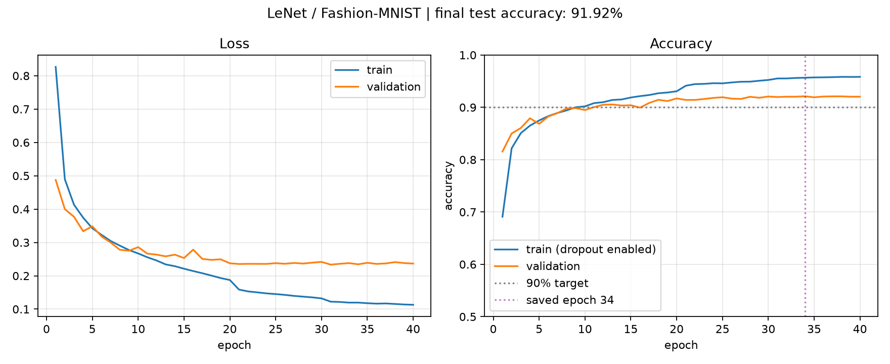

# 《动手学深度学习》PyTorch 学习记录

按《动手学深度学习》课程整理的代码练习、学习笔记和实验记录。当前内容覆盖 PyTorch 基础、线性模型、多层感知机，以及 LeNet 到 ResNet 的卷积网络示例，后续继续补充。

这是课程学习仓库，网络结构和主要示例来自教材；在示例基础上做了本地运行适配、调试和笔记补充，不代表已经完成整本书或对所有网络完成了完整训练。

## 内容索引

编号沿用个人学习时的记录顺序，不完全对应教材章节号；部分笔记和代码的文件编号略有差异。

| 范围 | 学习内容 |
| --- | --- |
| 01–04 | 张量操作、数据预处理、线性代数、自动求导 |
| 05–10 | 线性回归、损失函数、Fashion-MNIST、Softmax 分类 |
| 11–16 | 多层感知机、过拟合、权重衰退、Dropout、数值稳定性与初始化 |
| 18–22 | 模型构造、参数管理、自定义层、模型保存与设备迁移 |
| 23–26 | 卷积、填充与步幅、多输入输出通道、池化 |
| 27–33 | LeNet、AlexNet、VGG、NiN、GoogLeNet、BatchNorm、ResNet |

`.py` 为代码，`.md` 为学习笔记。笔记保留短句、公式和代码解释的记录方式。

可以先看：

- [改进版 LeNet 实验代码](27-LeNet.py)
- [卷积的推导与基本概念](23-从全连接到卷积.md)
- [多输入输出通道](25-多输入输出通道.md)
- [批量归一化笔记](32-批量归一化.md)与[实现](32-批量归一化.py)
- [ResNet 笔记](33-ResNet.md)与[实现](33-ResNet.py)

## 已保存的 LeNet 实验

本地保存的一次改进版 LeNet / Fashion-MNIST 实验结果：

| 项目 | 记录 |
| --- | --- |
| 训练 / 验证 / 测试 | 54,000 / 6,000 / 10,000 |
| 训练轮数 | 40 |
| 选择模型的依据 | 验证集准确率最高 |
| 最佳轮次 | 34 |
| 最佳验证准确率 | 92.12% |
| 测试准确率 | 91.92% |
| 随机种子 | 42 |
| 运行设备 | Apple MPS |

改动包括 32/64 卷积通道、ReLU、最大池化、Dropout 与权重衰退，具体配置见 [config.json](lenet_results/config.json)，结果见 [result.json](lenet_results/result.json)，逐轮记录见 [history.json](lenet_results/history.json)。这不是原版 LeNet-5 的基准结果，也不代表所有模型的实验表现。

### 实验过程与 AI 辅助说明

这次实验从课程中的 LeNet 示例开始。我先尝试自行调整训练参数，准确率未达到 90% 的目标后，向 AI 求助排查，并在 AI 辅助下调整了实现。上面的 91.92% 是辅助调整后版本保存的测试结果；网络结构和训练方案的修改包含 AI 的建议与协助。

早期每次调参的设置和结果没有在本仓库形成完整记录。下面根据现有代码与配置，说明目前能确认的内容。

当前代码保留了 `--original` 对照结构。它采用课程风格的 6/16 通道、Sigmoid 和平均池化；默认运行的版本有以下结构差别：

| 修改点 | `--original` 对照结构 | 当前默认版本 | 需要理解的作用 |
| --- | --- | --- | --- |
| 卷积输出通道 | 6、16 | 32、64 | 增加特征表示容量，也增加参数和计算量 |
| 激活函数 | Sigmoid | ReLU | 正半轴不饱和，可能让优化更容易；效果仍需实验比较 |
| 池化 | 平均池化 | 最大池化 | 从平均局部响应变为保留较强的局部响应 |
| 隐藏层 Dropout | 无 | 两处 `p=0.2` | 训练时引入随机丢弃，缓解过拟合；评估时关闭 |

`--original` 在这里是同一训练程序里的结构对照开关，仍使用当前程序的初始化、优化器和训练流程，不等于完整复现历史上的原版 LeNet-5。

已保存实验的训练设置：40 轮、batch size 128、SGD、分段学习率 0.1 → 0.03 → 0.01、权重衰退 0.0001、Xavier 权重初始化与零偏置，随机种子为 42。数据只做 `ToTensor`，按验证集准确率选模型，再评估测试集。这些是当前版本的配置，不能据此还原最初尝试过哪些参数。

这次实验需要分清的几点：

- 改学习率、批量大小和轮数属于训练参数调整；改通道数、激活和池化，也改变了网络结构或计算方式。
- 容量增加和正则化的作用不同。更大的网络不保证测试准确率更高，Dropout 和权重衰退也要结合训练情况理解。
- 多项设置一起改后得到一次较好的结果，不能直接说明每一项各自提高了多少；91.92% 是这次配置的实验记录。
- 训练和评估要分开：Dropout 在两种模式下行为不同，模型选择依赖验证集，测试集用于最后评估。

目前继续对照课程和代码理解这些调整。后续准备固定数据划分、随机种子和训练预算，先跑结构对照，再逐项比较修改的效果，把理解落实到可检查的实验记录里。



模型权重未提交。仓库中的 `--evaluate` 用法需要本地先训练生成检查点；仅下载这些实验记录不能直接恢复模型权重。

## 运行方式

本地主要环境为 Python 3.11、PyTorch 2.8.0、torchvision 0.23.0、D2L 1.0.3。`requirements.txt` 记录当前使用的主要依赖版本；没有在全新机器上重新安装并完整验证整套环境。

```bash
python3.11 -m venv .venv
source .venv/bin/activate
python -m pip install -r requirements.txt
python -m pip install --no-deps d2l==1.0.3
```

D2L 1.0.3 声明的部分依赖固定在较旧版本，本地环境与其声明并不完全相同。上面的第二条安装命令保留现有依赖组合；运行中遇到兼容问题时仍需结合具体报错处理。

在仓库根目录运行示例：

```bash
python '06-线性回归简洁实现.py'
python '27-LeNet.py' --epochs 1 --workers 0
python '32-批量归一化.py'
```

- Fashion-MNIST 首次运行会下载。多数早期示例使用 `../data` 相对路径，因此运行目录要保持在仓库根目录；LeNet 使用相对脚本位置的数据目录。
- 较大的卷积网络会占用更多内存和训练时间。小批量检查与完整训练是两种不同的验证，仓库没有记录所有大模型的完整训练结果。
- 部分示例显式要求 CUDA 或 MPS GPU；没有可用 GPU 时会报错。`d2l.try_gpu()` 本身只检查 CUDA，部分脚本另外加入了 MPS 选择。
- Mac 上没有主入口保护的几个教学脚本使用单进程加载数据，避免多进程重复执行顶层训练。
- 普通 `.py` 的最终曲线通过 `plt.show()` 显示；D2L 的动态图在终端里不一定像 Notebook 一样实时刷新。
- CPU、小批量或形状检查不能代替目标设备上的完整训练验证。

## 后续学习

继续完成课程后续内容，补充未覆盖的章节；对已整理模型继续做完整训练、对比和问题记录。在基础更扎实后，再逐步学习图神经网络等相关内容。

## 学习来源与许可

- [《动手学深度学习》中文版](https://zh.d2l.ai/)
- [D2L 官方仓库](https://github.com/d2l-ai/d2l-en)
- [PyTorch 文档](https://docs.pytorch.org/)

教材作者：Aston Zhang、Zachary C. Lipton、Mu Li、Alexander J. Smola。本仓库参考并改编教材示例，加入了个人笔记、本地运行调整及调试修正。相关上游版权和许可声明保留在仓库中：教材文字与其改编内容遵循 [CC BY-SA 4.0](LICENSE)，教材示例代码遵循上游的 [LICENSE-SAMPLECODE](LICENSE-SAMPLECODE)，二者区别见 [LICENSE-SUMMARY](LICENSE-SUMMARY)。不将课程中的经典网络或示例标为原创研究成果。
